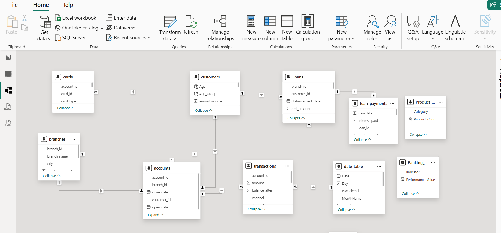
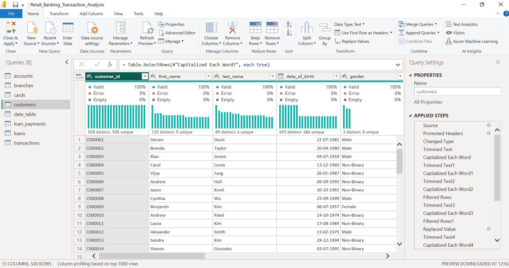
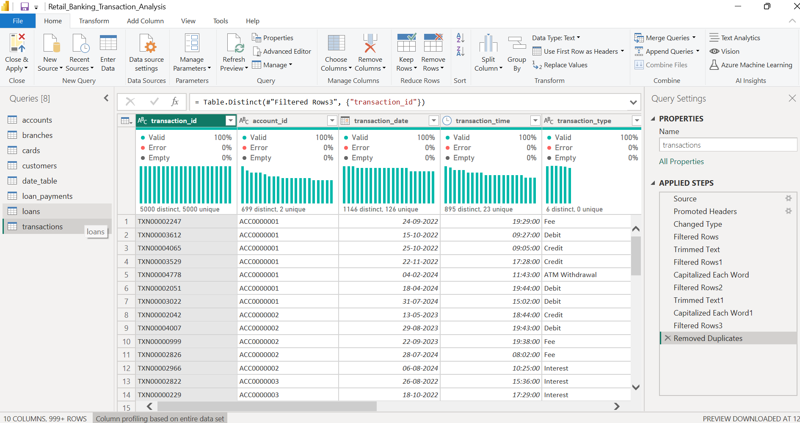

# Retail Banking Transaction Analysis | Power BI

## Project Overview
This project focuses on analysing retail banking data using Power BI to understand customer profiles, account performance, transaction trends, loan repayment behaviour, and card usage.

An interactive six-page dashboard was developed to provide insights into banking operations and support data-driven decision-making.

## Tools & Technologies
- Power BI
- Power Query
- DAX
- Data Modelling

## Dataset Overview
The project uses eight source tables:
- Customers – 500 records
- Accounts – 700 records
- Branches – 40 records
- Cards – 600 records
- Loans – 300 records
- Loan Payments – 2,000 records
- Transactions – 5,000 records
- Date Table

## Dashboard Pages

1. **Customer Analysis** – Customer demographics, age groups, segments, and city distribution.
2. **Account & Branch Analysis** – Account types, account balances, branch performance, and account status.
3. **Transaction Analysis** – Transaction amounts, types, channels, trends, and status distribution.
4. **Loan Analysis** – Loan amounts, outstanding balances, loan types, and payment status.
5. **Card Analysis** – Card types, networks, activation status, credit limits, and reward points.
6. **Executive Summary** – Key banking KPIs, product overview, performance indicators, and management insights.

## Key Performance Indicators
- Total Customers: 500
- Total Accounts: 700
- Total Transaction Amount: 35.89M
- Transaction Success Rate: 34%
- Total Loan Amount: 72.21M
- Loan Payment Delinquency Rate: 48%
- Active Card Rate: 6%
- Multi-Product Customer Rate: 63%

## Key Insights
- Customers aged 50 and above represent the largest age group.
- Jacksonville branch has the highest number of accounts.
- Transfers are the most common transaction type.
- Education loans have the highest loan count and outstanding balance.
- Debit cards are more commonly issued than credit cards.
- Card activation is low, highlighting an opportunity to improve activation.

## Skills Demonstrated
- Data cleaning and transformation using Power Query.
- Data modelling and table relationships.
- Creating calculated measures using DAX.
- Developing interactive dashboards and KPI visualisations.
- Analysing business trends and communicating insights.

## Project Files
- Power BI dashboard (.pbix)
- Dashboard report (.pdf)
- Project screenshots and documentation

---

## Data Model

## Data Cleaning & Transformation

### Customers Table

### Transactions Table

---

## Copyright

© 2026. All rights reserved.

This project is shared for portfolio and demonstration purposes.
Reproduction, redistribution, or reuse of this project without permission is not authorized.
